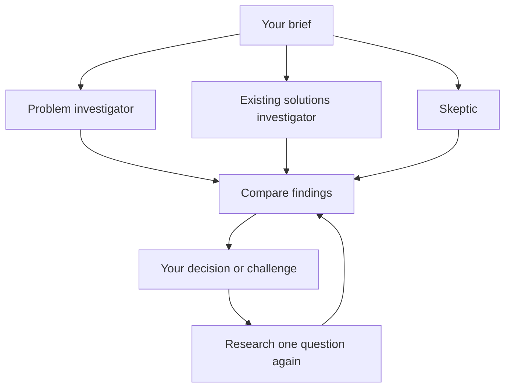

# Three Angles

Give an idea to three independent investigators. Compare what they find, challenge a conclusion, and decide what to test next.

I built this for people who want to investigate an idea before spending time building it. Web research often confirms the first appealing explanation. Three Angles deliberately separates three questions:

- **Problem:** Who experiences this problem, and what do they do today?
- **Existing solutions:** What already exists, and where does the idea overlap?
- **Skeptic:** Which assumption could make the idea fail?

The useful part happens after the first reports. Select **Challenge** on a finding and give one investigator a specific question. It does new research, keeps the previous report, and updates the combined recommendation. The final decision remains yours.

## Run locally

Requires Python 3.10+ and a browser. The app has no third-party Python dependencies.

```bash
python3 server.py
```

Open http://127.0.0.1:8766. On macOS, you can also double-click `Start.command`. Keep the server running while research is in progress. If another app uses that port, run `python3 server.py --port 8767`.

Click **Connect your tools** and configure a Nebius or Fireworks model with native function calling, plus a Tavily API key. Use the exact model ID enabled on your account. Keys stay in page memory and active server jobs; they are excluded from saved investigations and exports. Reloading clears the connection. Provider calls use your account credits.

For a preview without keys, choose **Open a worked example**. It is prepared content, clearly labeled, and makes no model or search calls.

## Try this investigation

> An assistant for small remote teams that turns recurring meeting transcripts into a searchable log of decisions, owners and unresolved questions. Investigate the documented problem, overlap with existing meeting tools, and assumptions that could make this fail. Focus on finding the latest decision when it changes across meetings.

Then challenge a finding:

> Check whether the named products document tracking decisions that are reversed across meetings. Separate confirmed features from capabilities you could not verify. Does this change the recommendation?

## How it works



Each investigator has a separate model conversation, source registry and tool history. Python worker threads run them concurrently. They use the same configured model, with different role instructions. A separate synthesis call compares the finished reports using a structured compile_recommendation tool result. Native tool-call batches are handled sequentially, and a response without a tool call receives a bounded correction within the existing call limit.

The three tools are `search_web`, `open_source`, and `publish_findings`. An investigator chooses a tool, receives its result, and chooses the next step. Each round allows at most seven model calls, two searches and three opened sources per investigator. Repeated successful searches are blocked; already-opened sources can be reread from cached text without another extraction. Transient service errors retry once. The initial round allows up to 21 investigator calls plus one synthesis call; retries are additional HTTP attempts.

Tavily provides public-web search and extraction. Nebius or Fireworks supplies the language model through native tool calls. This project uses custom Python orchestration, not LangGraph, a vector database, or a trained custom model.

## History and recovery

SQLite stores briefs, evidence, reports, revisions and human decisions in `.data/investigations.sqlite3`. The model selects excerpt IDs from opened sources; the application inserts the corresponding verbatim text. Unknown IDs and unopened citations are rejected. Findings distinguish observed source claims from inferences and unanswered questions. A quote match establishes text provenance, not whether the conclusion follows from it.

Completed reports remain available if another investigator fails. You can retry that investigator. When its search returned sources but no report was completed, recovery reuses those saved results without another web search. Source extraction may still be needed for pages not previously opened. If only the final comparison fails, **Retry comparison using saved research** avoids repeating searches. Stopping research prevents further steps; a provider request already accepted may still be billed. Restarting the server marks unfinished work interrupted and preserves its earlier evidence.

This is a local research workspace. It does not send messages, make purchases or publish research externally. Public pages can expose overlap and assumptions; product demand still needs interviews or experiments.

## Code and validation

| File | Responsibility |
| --- | --- |
| `research.py` | Tool loop, model transport, specialist roles, persistence and recovery |
| `server.py` | Local HTTP server and request handling |
| `src/` | HTML, CSS and JavaScript interface |
| `sample.py` | Curated example with separate sample labeling |
| `tests/test_research.py` | Orchestration, provider-adapter and HTTP tests |
| `docs/` | Architecture, project overview, validation and demo guide |

```bash
python3 -m unittest discover -s tests -v
```

**35 automated tests pass** as of October 31, 2026. Tests use simulated provider responses to exercise concurrency, follow-ups, cancellation, tool errors and source checks. They do not measure live research quality. A live Nebius/Tavily investigation and final comparison also completed on October 31, 2026, after the recovery fixes. The comparison surfaced a counterexample to the initial gap claim and recommended reshaping the idea. This verifies the workflow, not general research accuracy; the detailed record is in `docs/VALIDATION.txt`.

## Week 3 materials

- [Project overview](docs/Three_Angles_Project_Overview.docx)
- [Five-minute demo guide](docs/DEMO_GUIDE.md)
- [Architecture and workflow notes](docs/PROJECT.md)
- [Validation record](docs/VALIDATION.txt)

The source pack for the curated example contains short snapshots from the GitLab communication handbook and official Otter and Fireflies pages. Live investigations retrieve their own sources. No model training was performed.

Design references reviewed during submission preparation: [STORM and Co-STORM](https://github.com/stanford-oval/storm), [Deep Agents](https://github.com/langchain-ai/deepagents), and [Open Deep Research](https://github.com/langchain-ai/open_deep_research). These are references, not libraries used by this implementation.
