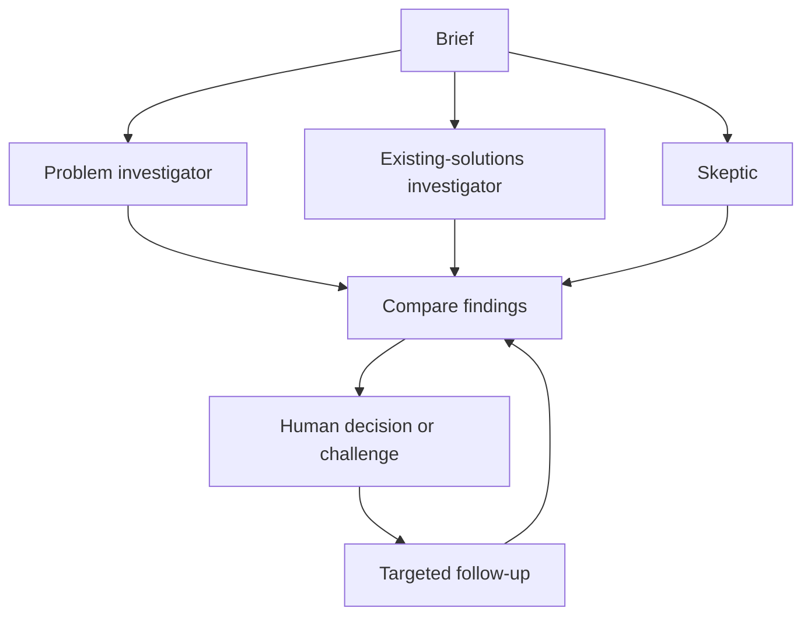

# Architecture

## Research flow

A brief starts three independent investigator conversations: problem, existing solutions and skeptic. Each has its own role instructions, source registry and tool history. Python worker threads run the first round concurrently.

The model chooses a native tool call. Python validates and executes it, returns the observation, and requests the next action. Nebius and Fireworks are supported model providers; Tavily handles web search and extraction. The orchestration is implemented directly in Python.

## Sources and reports

`search_web` returns source IDs. `open_source` reads a source and returns bounded excerpts with IDs. In `publish_findings`, the model selects those excerpt IDs; the application inserts the original text. Unknown excerpt IDs and citations to unopened sources are rejected.

Reports distinguish source claims, investigator inferences and untested questions. This checks where quoted text came from. It does not establish whether a source is accurate or whether the conclusion follows from it.

A separate native `compile_recommendation` call compares the completed reports. It returns a recommendation, references to findings that need discussion, and a proposed next experiment.

## Follow-ups and state

A challenge starts a new round for one investigator. Previous reports are retained, the comparison is invalidated, and a new comparison uses the current reports when the follow-up completes.

SQLite stores briefs, events, sources, revisions and human decisions. Updates are serialized to preserve concurrent worker writes. Credentials are passed to active clients and are excluded from persisted investigations and exports.

## Budgets and recovery

Each investigator round allows seven model calls, two searches and three opened sources. Native tool-call batches are processed sequentially. Excess source requests receive budget feedback. Repeated successful searches are blocked; cached source text can be reread without another extraction.

Transient service errors retry once. A failed investigator retains its evidence and completed reports. Recovery can reuse saved search results without another search. A failed comparison can be retried separately. Restarting the server marks unfinished work interrupted. Cancellation stops subsequent steps, although an already accepted provider request may still incur charges.

## Interface

The browser uses plain HTML, CSS and JavaScript. Three color-coded investigator panels show progress, findings and source activity. The evidence inspector, challenge action, revision history and decision notes keep review in the same workspace.

The app runs on a local Python HTTP server. Hosted mode separates anonymous visitor workspaces using a secure cookie and separate SQLite files. `HOSTED=1` enables this mode; `HOST`, `PORT` and `DATA_DIR` configure the runtime. The Render Blueprint uses temporary storage on the free plan.
