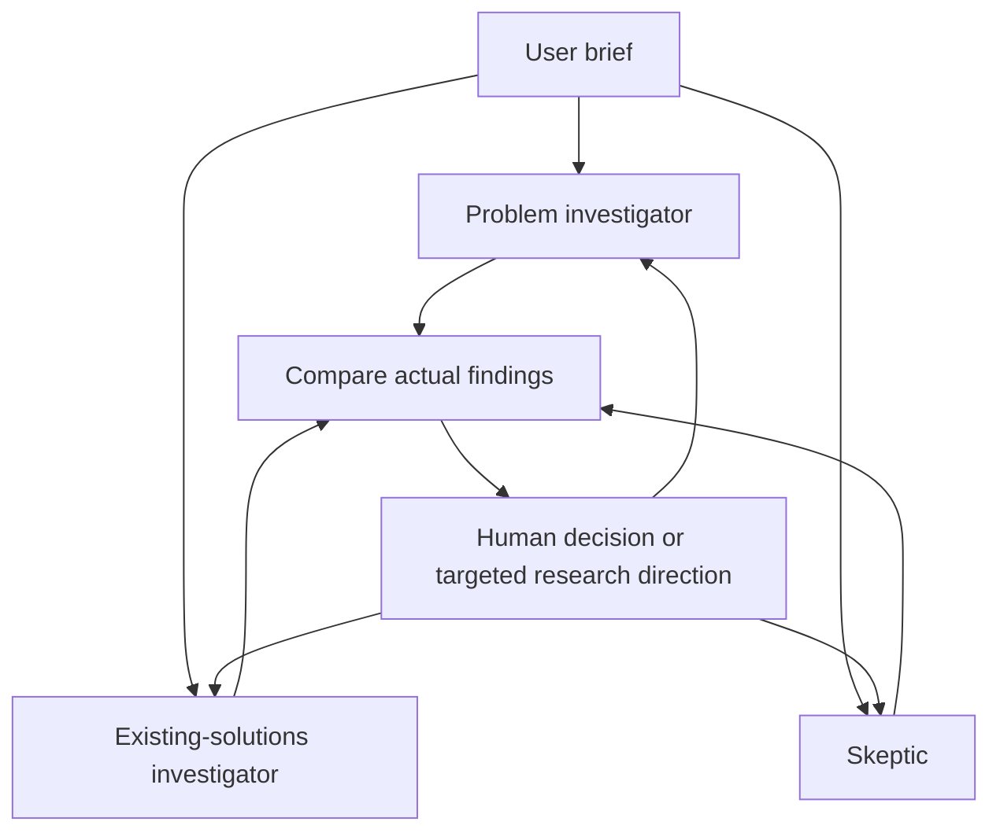

# A practical project, not a staged debate

## Intended user and outcome

A person considering a product/project idea wants to discover whether a real workflow exists, what overlaps with existing solutions, and which assumption needs testing first. They enter one brief and receive three independently researched perspectives, a comparison of material issues and a concrete next experiment. They retain the final decision.

## Concrete behavior

The investigator chooses a query, calls search, opens source IDs and submits findings through a validated native tool. The UI shows the actual query and observations. The roles run in separate model conversations concurrently. Each sees its own first-round evidence rather than a shared drafted answer.

Clicking **Challenge** creates an explicit research direction for the selected investigator. It performs new searches/openings under a new revision. The other investigators' reports remain. The synthesis is invalidated, the prior version is archived, and a new synthesis is generated from the current reports. This is the central interaction to demonstrate.

## Architecture

Each investigator uses search, source opening and report submission. SQLite serializes event/report updates; native worker threads execute the independent jobs in parallel. Credentials are passed to the active transport client, not the persisted case.

## Week 3 demonstration

1. **Brief:** enter a specific idea with a target user and present workaround.
2. **Actual work:** show different queries and opened sources from the three investigators.
3. **Specific findings:** open a named competitor capability and a distinct observed workflow example. Point out what remains unproven.
4. **Human direction:** select a material question and ask one investigator to search for a counterexample or verify feature overlap.
5. **Changed result:** show the new revision, preserved old report and recalculated synthesis. Do not claim the conclusion must change; no change is legitimate if the evidence supports it.
6. **Decision:** record pursue, reshape, drop or more research, with a rationale and next observable experiment.

## Evaluation

Automated tests verify actual concurrent worker execution, independent contexts/tool registries, targeted follow-up isolation, retained revisions/sources, invalid quote rejection, synthesized finding references, bounded loops, temporary-service retries, partial failures, cancellation, restart recovery, atomic SQLite event writes, local HTTP behavior and credential exclusion.

The provider responses in these tests are simulated. No API keys were supplied during development. Real-provider accuracy, query quality, source quality and product usefulness have not been established by these tests. Before a live demo, validate the exact chosen model and Tavily account. Add a small independently labeled benchmark of briefs if making performance claims.

## Creativity and user experience

The custom interface starts with the user's idea rather than workflow internals. Independent perspectives appear in color-coded research notebooks. The discussion distinguishes a contradiction from a trade-off or missing evidence. Challenges create work; they do not generate a decorative debate. There is no invented consensus score or forced “winner.”

## Implementation history

The user rejected the earlier finance and agent-rehearsal prototypes as repetitive or theoretical, then authorized three investigators with distinct roles. This build implemented a new live research backend and a brief-first interface. It did not merely rename the prior dashboard.

The worked example is deliberately curated and labeled. It uses a real documentation practice and named product claims so the sample illustrates an actual overlap question, while preserving the distinction between sample text and live execution.

## Known limits

Web evidence cannot establish product demand by itself. A vendor's published claim is not an independent test. Role prompts may still yield correlated reasoning because the same model provider can serve all three sessions. Quote checks cannot establish entailment. Searches and extraction may miss sources or truncate text. Synthesis may fail; partial reports are retained. A localhost app is not a hosted multiuser service.
